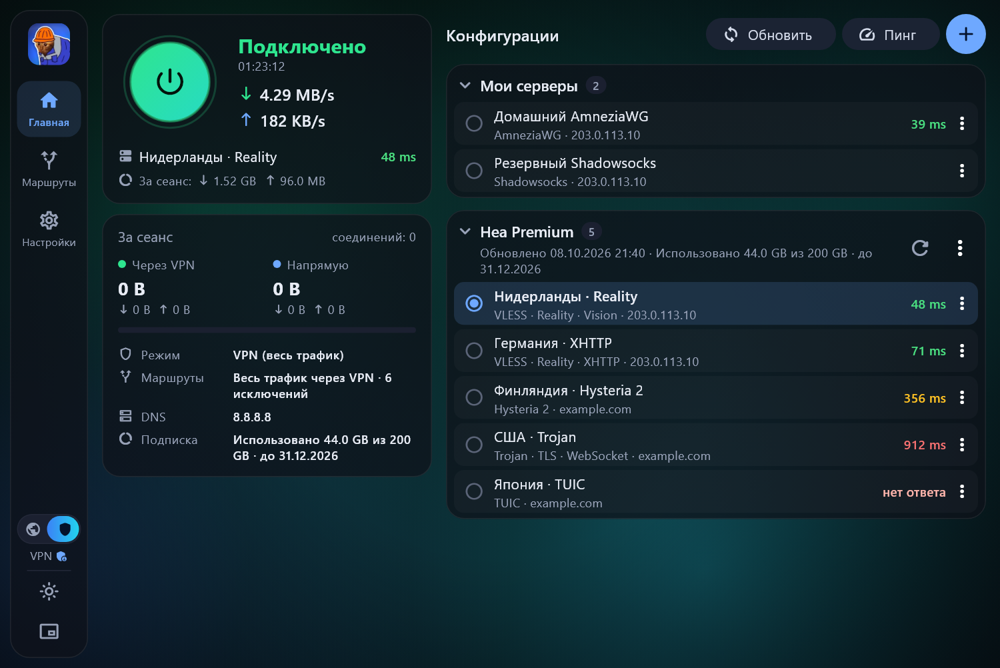
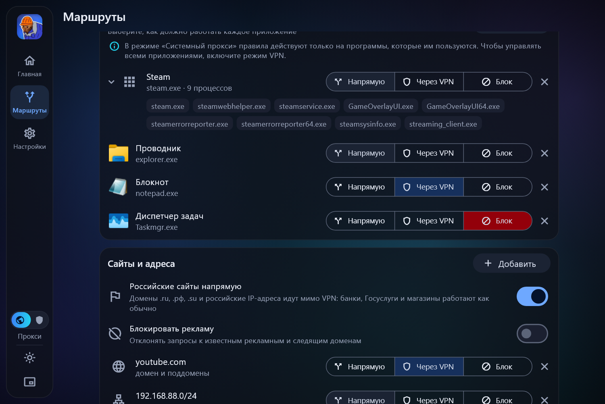

<p align="center"></p>
<h1 align="center">HeaNetwork</h1>
<p align="center">VPN-клиент для панели <b>3x-ui</b> с маршрутизацией по приложениям и защитой от блокировок</p>

<p align="center">
  <a href="https://github.com/zarkon4631/HeaNetwork/releases/latest"></a>
  <a href="https://github.com/zarkon4631/HeaNetwork/releases"></a>
  <a href="LICENSE"></a>
  <br>
  
  
  
  <br>
  
  
  
  
</p>

<p align="center"><a href="https://github.com/zarkon4631/HeaNetwork/releases/latest"><b>Скачать</b></a> · <a href="CHANGELOG.md">Что нового</a> · <a href="#english">English</a></p>

| | |
|---|---|
|  |  |

## Возможности

- **Протоколы**: VLESS, VMess, Trojan, Shadowsocks, WireGuard, AmneziaWG, Hysteria 1/2, TUIC, SOCKS, HTTP; Reality, XHTTP, WebSocket, gRPC, HTTPUpgrade, mKCP. MASQUE и транспорт XDRIVE из 3x-ui 3.10 ядро пока не поддерживает: такие серверы приложение называет под подпиской и в список не добавляет.
- **Подписки 3x-ui**: обычные и JSON, остаток трафика и срок, объявления, HWID для лимита устройств, ключи `vpn://`.
- **Маршрутизация из панели**: правила в формате Happ, которые администратор задал в 3x-ui, приходят вместе с подпиской.
- **Маршрутизация по приложениям**: *Напрямую / Через VPN / Блок* для каждой программы. Steam, Epic, Discord и другие добавляются сразу со всеми своими процессами.
- **Маршрутизация по сайтам**: российские сайты напрямую, блокировка рекламы, свои правила.
- **Защита от блокировок (DPI / ТСПУ)** включена всегда: разбиение TLS-записей и отпечаток браузера, плюс всё, что задано в самом сервере.
- **Режимы**: VPN (весь трафик, по умолчанию) и системный прокси.
- **Android**: виджет, кнопка в шторке, интерфейс для Android TV и приём подписки с телефона по QR-коду.
- **Ещё**: пинг по TCP, флаги стран, график скорости, выбор DNS, обновления с проверкой SHA-256, тёмная и светлая темы, русский и английский.

## Установка

| Платформа | Файл со [страницы релизов](https://github.com/zarkon4631/HeaNetwork/releases/latest) |
|---|---|
| Windows 10/11 x64 | `…-windows-x64-setup.exe` или `…-portable.zip` |
| Android 7.0+ и Android TV | `…-android-arm64-v8a.apk`, для старых приставок `…-armeabi-v7a.apk` |

Установщик Windows не подписан сертификатом: в окне SmartScreen нажмите «Подробнее» → «Выполнить в любом случае». Контрольные суммы лежат в `SHA256SUMS.txt`.

**Быстрый старт:** скопируйте ссылку подписки в панели 3x-ui → в приложении **+** → **Вставить из буфера** → кнопка подключения. В режиме VPN Windows при запуске попросит права администратора.

## Частые вопросы

<details><summary>Не подключается</summary>

Откройте **Настройки → Журнал**. На Windows журнал текущего и прошлого сеансов также лежит в файлах `core.log` и `core.prev.log` — кнопка с папкой на странице журнала.
</details>

<details><summary>Программа не видит VPN в режиме «Системный прокси»</summary>

В этом режиме через VPN идут только программы, которые читают настройки прокси Windows. Игры и консольные программы (git, npm, Claude Code) идут напрямую. Включите режим **VPN** слайдером слева снизу.
</details>

<details><summary>Как раздать правила маршрутизации всем пользователям</summary>

В 3x-ui: настройки подписки → маршрутизация Happ. Приложение читает заголовок `Routing` при каждом обновлении подписки; списки `geosite:` и `geoip:` загружает само. Ссылку `happ://routing/…` можно также вставить вручную на странице «Маршруты». Собственные правила пользователя имеют приоритет.
</details>

<details><summary>Подписка на телевизор</summary>

На телевизоре **+** → **Получить с телефона (QR)**, отсканируйте код телефоном в той же сети Wi-Fi и вставьте ссылку на открывшейся странице.
</details>

## Сборка

Нужен [Flutter](https://docs.flutter.dev/get-started/install) 3.47+.

```powershell
powershell -ExecutionPolicy Bypass -File tool\fetch_assets.ps1   # ядро и списки, проверяются по SHA-256
flutter pub get
flutter test
flutter build windows
```

Для Android дополнительно Go, JDK 17 и NDK: `bash tool/build_libbox.sh`, затем `flutter build apk --split-per-abi`. Каждый коммит собирается в [GitHub Actions](.github/workflows/build.yml); тег `v1.2.3` публикует релиз с описанием из [`CHANGELOG.md`](CHANGELOG.md).

Ядро — [sing-box-extended](https://github.com/shtorm-7/sing-box-extended), версия закреплена в [`tool/core.json`](tool/core.json). Лицензия — [GPL-3.0](LICENSE).

## English

HeaNetwork is a VPN client for **Windows**, **Android** and **Android TV**, made for 3x-ui panels: the protocols the panel offers (all but MASQUE and the XDRIVE transport, which the core does not have yet), subscriptions with HWID, routing rules pushed from the panel (Happ format), per-application routing with program groups, always-on anti-DPI measures, TCP ping, self-update verified by SHA-256. Built with Flutter on the [sing-box-extended](https://github.com/shtorm-7/sing-box-extended) core. [Download](https://github.com/zarkon4631/HeaNetwork/releases/latest) · GPL-3.0.
